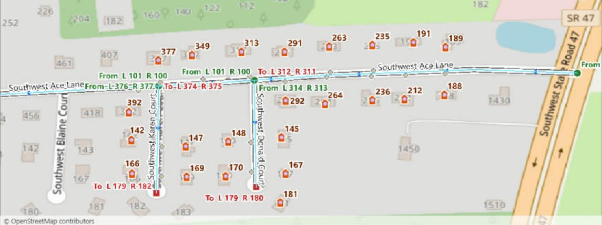
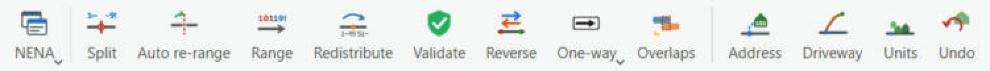
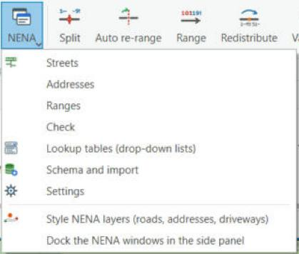
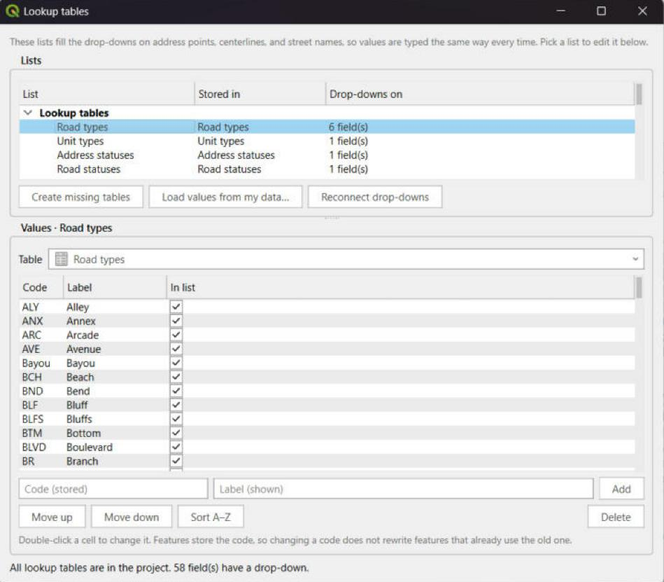
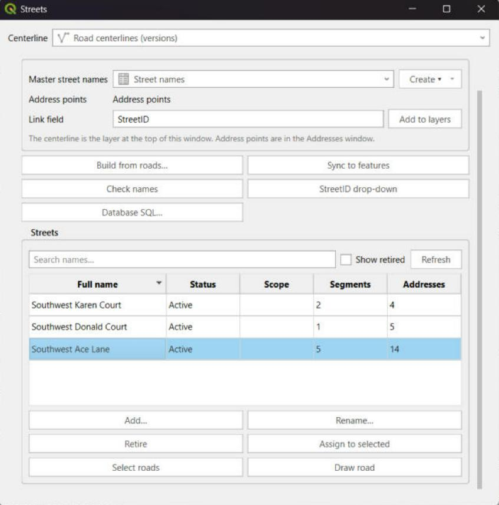
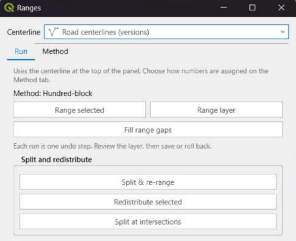

# NENA Addressing and RCL Tools for QGIS

**A QGIS plugin that handles the day-to-day work of 911 addressing.**

Keep one clean list of street names, give your road centerlines their address ranges, and place new addresses by clicking on the map. The plugin also checks your data before you send it to your 911 authority or state.



*Roads show which way they run (green dot = start, red square = end) with the From/To numbers for each side. Address points are labelled with their house numbers.*

It follows the NENA NG9-1-1 layout for road centerlines and site/structure address points. Your data can be in a GeoPackage, a file geodatabase, a shapefile, or any database you've connected in QGIS (PostgreSQL, SQL Server, and others).

| | |
|---|---|
| **Works with** | QGIS 3.34 or newer, including QGIS 4 |
| **Extra software** | None |
| **Version** | 3.6.11 |
| **License** | [GPL-2.0-or-later](LICENSE) |
| **Source** | https://github.com/pwizzle77-cmd/qgis-nena-addressing-tools |

---

## Contents

- [What can it do?](#what-can-it-do)
- [Install](#install)
- [Get started in 10 minutes](#get-started-in-10-minutes)
- [How to configure](#how-to-configure)
- [The toolbar and windows](#the-toolbar-and-windows)
- [Map styles and line direction](#map-styles-and-line-direction)
- [Drop-down lists (lookup tables)](#drop-down-lists-lookup-tables)
- [Street names](#street-names)
- [Placing addresses](#placing-addresses)
- [Address ranges on roads](#address-ranges-on-roads)
- [When you edit a road](#when-you-edit-a-road)
- [Checking your data](#checking-your-data)
- [Settings](#settings)
- [New tables, importing, and edit history](#new-tables-importing-and-edit-history)
- [Good to know](#good-to-know)
- [Words used in this guide](#words-used-in-this-guide)
- [What's new](#whats-new)
- [For developers](#for-developers)

---

## What can it do?

| You want to… | The plugin… |
|---|---|
| Stop misspelled and duplicate street names | Keeps one master street-name list. Rename a street once and every road and address using it updates. |
| Draw a new road | Pick the street name, click **Draw road**, draw the line. It's named and ranged for you. |
| Range your centerlines | Assigns From/To numbers by hundred-block, distance, length, or from existing address points. |
| Add new addresses quickly | You click the road, then the building. The house number, side, ZIP, ESN, and community fill in for you. |
| Number apartments and townhomes | Places many units under one house number: 1, 2, 3 or 101, 102 or A, B, C. |
| Keep attribute values consistent | Gives fields drop-down lists, so everyone picks *Main Street*, not *Main St.* or *MAIN*. |
| Split roads without breaking ranges | Divides the range across the pieces automatically when you split. |
| See which way a road runs | Styles roads with direction arrows, a green dot where each line starts, and a red square where it ends. |
| Fix a road drawn backwards | **Reverse** flips the line and swaps its left/right values and ranges to match. |
| Catch problems before submitting | Finds overlapping ranges, gaps, wrong odd/even sides, missing values, and MSAG mismatches. |
| Start fresh or move old data in | Creates empty NENA tables and imports your existing layers into them. |

---

## Install

**From QGIS (easiest):** go to **Plugins → Manage and Install Plugins → All**, search for **NENA Addressing and RCL Tools**, and click **Install Plugin**.

**From a zip:** download the zip from the [releases page](https://github.com/pwizzle77-cmd/qgis-nena-addressing-tools/releases), then use **Plugins → Manage and Install Plugins → Install from ZIP**. The zip has `nena_addressing_and_rcl_tools/metadata.txt` at the top.

**By hand:**

1. Copy the plugin folder and name the copy **`nena_addressing_and_rcl_tools`**. The folder must contain `metadata.txt`.
2. Put the copy in your QGIS plugins folder:

| QGIS | Windows | macOS | Linux |
|---|---|---|---|
| 4 | `%APPDATA%\QGIS\QGIS4\profiles\default\python\plugins\nena_addressing_and_rcl_tools` | `~/Library/Application Support/QGIS/QGIS4/profiles/default/python/plugins/nena_addressing_and_rcl_tools` | `~/.local/share/QGIS/QGIS4/profiles/default/python/plugins/nena_addressing_and_rcl_tools` |
| 3.34+ | `%APPDATA%\QGIS\QGIS3\profiles\default\python\plugins\nena_addressing_and_rcl_tools` | `~/Library/Application Support/QGIS/QGIS3/profiles/default/python/plugins/nena_addressing_and_rcl_tools` | `~/.local/share/QGIS/QGIS3/profiles/default/python/plugins/nena_addressing_and_rcl_tools` |

3. Restart QGIS.
4. Go to **Plugins → Manage and Install Plugins → Installed** and tick **NENA Addressing and RCL Tools**.

**Had an older copy in a folder called `nena_rcl_tools`?** From 3.6.4 the plugin's folder is `nena_addressing_and_rcl_tools`. Uninstall the old copy first (**Plugins → Manage and Install Plugins → Installed → NENA Addressing Tools (or NENA RCL Tools) → Uninstall Plugin**), or delete the old `nena_rcl_tools` folder while QGIS is closed, so you don't end up with two copies. Your project settings, lookup tables, and street names are stored in your project and data, so nothing is lost.

When it's on, you'll see the **NENA Addressing and RCL Tools** toolbar and a **Vector → NENA Addressing and RCL Tools** menu.

---

## Get started in 10 minutes

This is the usual order for a county that already has road centerlines. For every setting, see [How to configure](#how-to-configure).

1. **Add your roads to the map.**
   Each road line should point the way the house numbers go up. Roads should be split where they meet (the plugin can do this for you later).

2. **Style the layers.** Click **NENA ▾ → Style NENA layers**.
   Roads now look like roads, with arrows showing which way each one runs. Look for roads whose arrows point the wrong way, select them, and click **Reverse**.

3. **Match your fields.** Open **NENA ▾ → Settings → Fields**.
   The plugin matches your columns to NENA names on its own, including older names like `L_F_ADD` and `STREETNAME`. Check the list, and fix anything it missed.

4. **Set up the drop-down lists.** Open **NENA ▾ → Lookup tables**.
   Click **Create missing tables**, then **Load values from my data**. Your attribute forms now have drop-downs for street type, county, ZIP, ESN, community, and more.

5. **Build your street-name list.** Open **NENA ▾ → Streets**.
   Pick or create a master street-name table, then click **Build from roads**. Choose one spelling for each street.

6. **Range the roads.** Open **NENA ▾ → Ranges**.
   Pick a method on the **Method** page. Try it on a few selected roads first, check the result, then range the rest.

7. **Place an address.** Click **Address** on the toolbar.
   Click the road, then click the building. An access point is saved 10 feet off the road.

8. **Check before you submit.** Click **Validate** on the toolbar.
   Overlapping ranges are selected for you so you can fix them first.

> 💡 **Your settings save automatically.** Your layer edits don't. Save your layers in QGIS when you want to keep the edits. Until then, everything the plugin did can be undone.

---

## How to configure

Work through this section once per county (or per project) before you start ranging and addressing. Most "it numbered it wrong" and "nothing happened" surprises come from a step here that was skipped.

**Where the settings are kept.** Settings save as you change them, but they are stored in your **QGIS project**:

- Field matching, defaults, ranging, editing, and check settings are stored **on the centerline layer** in the project.
- Street, address, lookup, side, and MSAG settings are stored **in the project** itself.

**Save the project (.qgz) after configuring**, or the settings are gone next time. To reuse the centerline settings in another project, use **Settings → Fields → Export…** and **Import…**.

### Configuration checklist

| ✓ | Step | Where | Needed for |
|---|---|---|---|
| ☐ | 1. Pick the centerline layer | Picker at the top of every window | Everything |
| ☐ | 2. Match the fields | Settings → Fields | Everything |
| ☐ | 3. Agency ID and NGUIDs | Settings → Editing → NGUID | New roads, splits, export |
| ☐ | 4. Default values (state, county, agency…) | Settings → Defaults | Complete attributes |
| ☐ | 5. ZIP, MSAG community, ESN on each side | Settings → Sides | Addresses, MSAG, export |
| ☐ | 6. Drop-down lists | NENA ▾ → Lookup tables | Consistent values |
| ☐ | 7. Master street names | NENA ▾ → Streets, Settings → Street rules | Draw road, renames, addresses |
| ☐ | 8. Line direction | Style NENA layers, Reverse | Correct left/right and numbers |
| ☐ | 9. Ranging method and parity | Settings → Ranging | Range, Split, Draw road |
| ☐ | 10. What happens while you edit | Settings → Editing | Split, merge, new roads |
| ☐ | 11. Address layers | NENA ▾ → Addresses | Place address, driveways, units |
| ☐ | 12. House-number rules | Settings → Address rules | Place address, units |
| ☐ | 13. Checks | Settings → Checks | Validate |
| ☐ | 14. **Save the project** | Project → Save | Keeping all of the above |

### 1. Pick the centerline layer

Every window has a **Centerline** picker at the top. It opens on the project's centerline and also follows the line layer that's active in the Layers panel. Version tables and driveways are never listed. The settings below belong to that layer, so check the picker shows the right one before you change anything.

### 2. Match the fields — Settings → Fields

| Setting | What to do |
|---|---|
| **Auto-map** | Matches your columns to NENA names, including older names such as `L_F_ADD`, `R_T_ADD`, and `STREETNAME`. Then check every row. A field left unmatched is ignored by ranging and checks |
| **Show optional fields** | Tick to see and match the optional NENA fields too |
| **Add mandatory** / **Add all fields** | Creates the missing columns on the layer (short names, safe for shapefiles) |
| **Street key** | Which name parts together identify one street. Pieces with the same key are numbered as one street and checked for overlaps. The default is all the name parts (pre-modifier through post-modifier) |
| **Field template ▾** | Loads your state's column list instead of the built-in NENA list |

The fields that must be matched for ranging: **FromAddr_L, ToAddr_L, FromAddr_R, ToAddr_R, Parity_L, Parity_R**, and the street-name parts. For addressing also match the left/right **ZIP (PostCode), MSAG community, and ESN** fields.

### 3. Agency ID and NGUIDs — Settings → Editing → NGUID

| Setting | What to enter | Default |
|---|---|---|
| **Agency identifier** | Your agency's domain-style ID, for example `psap.example.gov`. It goes into every new NGUID and fills empty **DiscrpAgID** values | Empty — **set this first** |
| **NGUID format** | `urn:emergency:uid:gis:RCL:{id}:{agency}` (NENA STA-006.2) or the older `RCL_{id}@{agency}` | STA-006.2 |
| **Unique part** | Random UUID, or the feature id | Random UUID |
| **Fill empty – selected / all** | Gives roads without an NGUID one — and a new one to a road that has the same NGUID as an older road (a split piece that kept the original's id) — and fills empty DiscrpAgID with the agency identifier. It does the same for the **Site_NGUID** of address points and the **DW_NGUID** of driveways | — |

If the agency identifier is empty, new and split roads, address points and driveways take the agency
(and format) the existing NGUIDs use — a split-off piece the one of the road it came from, an address
point the one of the other address points (else the driveways, the road, the centerlines, or
DiscrpAgID). Only when there are no NGUIDs at all do they stay empty, and a message says to set the
agency identifier.

### 4. Default values — Settings → Defaults

Values that rarely change. They are written **only into empty fields**; a value already on a road stays.

| Field | Typical value |
|---|---|
| **Country** (left/right) | `US` |
| **State** (left/right) | Your state, for example `FL` |
| **County** (left/right) | Your county, for example `Columbia County` |
| **Valid** (left/right) | `Y` |
| **One-way** | `B` (two-way). Mark one-way roads with **One-way ▾** |
| **Parity left / right** | **Leave blank.** Ranging writes the parity. A default here would be kept as the road's own parity (see step 9) |
| **Road status** | `ACT` (Active) — **filled in for you**. With lookup tables this box is greyed out: tick **Default** on a road status in Lookup tables instead |
| **Road class** | `Local` — **filled in for you**. With lookup tables, set it with **Default** in Lookup tables |
| **Discrepancy agency** | Your agency identifier (the same as step 3) |

New roads are **Active** with road class **Local** unless you change these two boxes; clear a box to stop filling that field. Once you have lookup tables, road status, road class and discrepancy agency follow the value ticked **Default** there (step 6), so there is one place to set them. (Your layer needs the RoadStatus and RoadClass fields: **Settings → Fields → Add all fields**.)

**Add a field** adds any other field you want filled. **Fill empty fields** writes the defaults onto the existing roads now; new roads get them as you add them.

### 5. ZIP, MSAG community, and ESN on each side — Settings → Sides

A road is often a boundary, so its left and right side can be in different ZIP codes, communities, or ESNs.

1. For **ZIP code**, **MSAG community**, and **ESN**, pick the polygon layer and the field that holds the value.
2. Optional: **Add boundary** for more polygons, such as incorporated municipality or county, and pick which centerline field each one fills.
3. Click **Calculate sides** to write the values onto both sides of every road.
4. Where a boundary crosses a road part-way, **Split where side changes** cuts the road there.

After that, **new and moved roads fill their own sides**: when you add a road (including **Draw road**), split one, or change its shape, its left and right values are read from these polygons. Turn this off with **Fill ZIP, MSAG, ESN… sides on new and moved roads** under Settings → Editing.

New addresses copy the values from their side of the road, so do this before placing addresses.

### 6. Drop-down lists — NENA ▾ → Lookup tables

1. **Create missing tables** (lists in red are missing).
2. **Load values from my data**, and untick typos before they're added.
3. **Reconnect drop-downs** after you add new layers or fields.
4. Add local values: your communities, ZIP codes, ESNs, road classes. For postal communities, set each one's **Parent** to its ZIP so the list narrows by ZIP.
5. **Tick Default** on the value new features should get in **Address statuses**, **Address types**, **Road statuses**, **Road classes**, **Placement methods** and **Discrepancy agencies**. Then click **Fill empty fields** to give it to the address points and roads you already have.

See [Drop-down lists](#drop-down-lists-lookup-tables) for details.

### 7. Master street names — NENA ▾ → Streets and Settings → Street rules

**In the Streets window:**

| Setting | What to do |
|---|---|
| **Master street names** | Pick the table, or **Create ▾** one in your GeoPackage or database |
| **Link field** | Usually `StreetID`. Click **Add to layers** to create it on the roads and address points |
| **Build from roads** | Builds the list from the names already on your roads. Pick one spelling per street |
| **StreetID drop-down** | Turns the link field into a searchable list of street names |

**In Settings → Street rules:**

| Setting | Choices | Default |
|---|---|---|
| **Scope** | County-wide, or per field value (unique within a community, city, ZIP, or ESN) | County-wide |
| **Compare** | Full road name, or ignore street type (*Oak St* = *Oak Ave*) | Full road name |
| **Sound-alike names** | Warn about *Smith* / *Smyth* | On |
| **Duplicates** | Block, or warn only | Block |
| **Street types…** | Add local types and abbreviations | Standard USPS/NENA list |
| **Keep the old name as a retired alias** | On a rename | On |
| **Edits typed into the master table cascade** | Update linked roads and addresses | On |
| **Picking a StreetID copies the name parts** | Onto the road or address | On |
| **Set DateUpdate** | On changed features | On |

### 8. Line direction

House numbers increase in the direction each road was drawn, and left/right is read in that direction. Click **NENA ▾ → Style NENA layers**, look at the arrows (green dot = start, red square = end), and **Reverse** any road drawn the wrong way. **Check** also lists pieces that run against their neighbours (*DIRECTION_CONFLICT*).

### 9. Ranging method and parity — Settings → Ranging

The default is **ranging by distance** (Interval, one number every 5.28 ft ≈ 1,000 numbers per mile), the usual method for rural and county-wide distance addressing. Hundred-block is still available for city grids.

| Setting | What it does | Default |
|---|---|---|
| **Ranging method** | **Interval** (by distance), Hundred-block, Proportional along length, or From address points | **Interval** |
| **Distance per number** + units | Ground distance for one address number. Use the same value as the house-number distance in step 12 | **5.28 feet** |
| **Scope** | Street chains (connected pieces with the same street key are numbered in order), or each feature on its own | Street chains |
| **Start numbering** | Continue from the connected piece upstream; keep the first piece's existing From; or always start at the base address | Continue from upstream |
| **Base address** | The number a street starts at when there's nothing upstream | **100** |
| **Block size** | Hundred-block only: numbers per block (1000 for some rural grids) | 100 |
| **Left side / Right side** | The parity used when a road has none | **Odd left, even right** |
| **Keep a valid existing Parity_L / Parity_R** | **The centerline's own parity is used first.** A road already marked O, E, B, or Z keeps it (Z = no addresses on that side). Untick to overwrite every road with the left/right setting | **On** |
| **Address points** (group) | The point layer, house-number field, and street field. Needed for the *From address points* method, and makes splits keep houses on the piece they front | Empty |
| **Overwrite existing ranges** | Off: only roads with empty or 0–0 ranges are filled | On |
| **Write Parity_L / Parity_R** | Writes the parity the range was built with | On |
| **Set DateUpdate** | On changed roads | On |
| **Connectivity tolerance** | How close two line ends must be to count as connected | 0.5 m |

**Parity, in short:** the road's own Parity_L / Parity_R comes first. Only a road with no parity (or an invalid one) gets the left/right setting. To give a road a parity on purpose, type it on the road before ranging; to start over, untick *Keep a valid existing Parity* for one run.

> 💡 Try **Range selected** on a few roads first and check the numbers before you use **Range layer**.

### 10. What happens while you edit — Settings → Editing

| Setting | What it does | Default |
|---|---|---|
| **Re-range pieces after Split Features** | Divides the original range across the pieces | On |
| **Split method** | Proportional and anchored to address points; proportional to length only; or from the address points | Anchored (recommended) |
| **Combine ranges after Merge** | The merged road gets the lowest From and highest To. Select the pieces before merging | Off |
| **Split existing roads where a new road creates an intersection** | Also used by **Draw road** | On |
| **…also where the new road crosses** | Turn off where you have overpasses | On |
| **After reshape / vertex edit** | Do nothing; recompute To by distance; or re-derive from address points | Do nothing |
| **Manage field split policies** | Ranges are copied to both pieces, NGUID is cleared on the new piece | On |
| **Give new and split-off features a new NGUID** | Uses the agency identifier from step 3, else the agency of the existing NGUIDs. A piece never keeps the original road's NGUID | On |
| **Fill ZIP, MSAG, ESN… sides on new and moved roads** | Reads each side from the polygons in step 5 when a road is added, split, or reshaped | On |

### 11. Address layers — NENA ▾ → Addresses

| Setting | What to do |
|---|---|
| **Address points** | Pick your site/structure address layer, or **Create** one |
| **Driveways** | Optional. Needed only for the **Driveway** tool |
| **Access points** | Pick or create the access-point layer. **Place address** saves one 10 ft off the road for each address |
| **Address schema → Template ▾** | Uses your state's address field list instead of the built-in NENA one |
| **Placement** | The placement value written on new points (default *Structure*) |
| **Show where selected addresses were addressed on the road** | Map markers for selected addresses (on by default) |

Also set the address-point layer under **Streets** (so renames update addresses) and on **Settings → Ranging → Address points** (so splits respect houses).

### 12. House-number rules — Settings → Address rules

| Setting | What it does | Default |
|---|---|---|
| **Method** | **Defined distance** (the segment's From plus one number per distance from its start), Interpolate within the segment's range, or Fixed frontage interval | **Defined distance** |
| **Distance per number** + units | Use the same value as the ranging distance in step 9 | **5.28 feet** |
| **Number at the road start** | Used only when the clicked segment has no From number | 100 |
| **Rounding** | Nearest, or round down | Nearest |
| **Parity** (left / right) | Used when the centerline has no parity of its own | **Odd left, even right** |
| **Use the centerline's own Parity_L / Parity_R first** | **On:** an O or E on the clicked side of the road decides odd/even. **Off:** the left/right setting always wins and a mismatch is only reported. A side marked **Z** never gets addresses | **On** |
| **Keep numbers increasing between neighbouring addresses** | Keeps order along the segment | On |
| **Number taken** | Use the next free number, add a suffix (101A), or ask | Next free number |
| **Overrides per community** | A different method, distance, or start number for one MSAG community, ESN, ZIP, city, or county | None |

### 13. Checks — Settings → Checks

Tick the checks you want, set the **Gap tolerance** (extra numbers allowed between pieces before a gap is reported), and an **Overlap scope** field if the same street name may repeat in different communities. For the MSAG comparison, load the MSAG table and pick its Street, Community, Low, High, and Odd/even columns on **Settings → Checks → MSAG extract**, then click **Compare to MSAG** on the Check window.

### 14. Save the project

**Project → Save.** The settings live in the project. Your layer edits are saved separately, with **Save Edits** on each layer.

### Quick test after configuring

1. Select two or three connected pieces of one street and click **Range**. Odd numbers should be on the left (looking from the green dot to the red square), and the numbers should continue from piece to piece.
2. Click **Address**, click one of those roads, then a building. The number should fall inside that side's From–To, with the right odd/even, ZIP, community, and ESN.
3. Click **Validate**. Fix anything it lists before ranging the whole layer.

---

## The toolbar and windows

### Toolbar

Every button has its name under the icon.



| Button | What it does |
|---|---|
| **NENA ▾** | Opens a window (Streets, Addresses, Ranges, Check, Lookup tables, Schema and import, Settings), or **Style NENA layers** |
| **Master Streets** | Opens the master street names window in one click |
| **Split** | Click a road to split it and divide its range between the two pieces |
| **Auto re-range** | Turns automatic re-ranging on or off after you split or merge roads |
| **Range** | Gives the selected roads an address range |
| **Redistribute** | Spreads one combined range across the selected pieces |
| **Reverse** | Flips the direction of the selected roads. Left/right values and ranges follow |
| **One-way ▾** | Marks the selected roads two-way (B), one-way From → To (FT), or one-way To → From (TF) for routing |
| **Validate** | Checks the whole centerline layer |
| **Overlaps** | Selects every road whose range overlaps another |
| **Address** | Places an address and an access point 10 feet off the road |
| **Driveway** | Draws a driveway from the road |
| **Units** | Places several units that share one house number |
| **Undo** | Removes the last address you placed |
| **History** | Shows every saved version of the selected road or address, what each save changed, and rolls it back to an earlier version |

### Windows

Open any window from the **NENA ▾** button.



| Window | Use it to |
|---|---|
| **Streets** | Manage the master street-name list, and see which roads and addresses use each name |
| **Addresses** | Choose your address, driveway, and access-point layers |
| **Ranges** | Assign From/To numbers, fill gaps, and split roads |
| **Check** | Find gaps, overlaps, and MSAG differences |
| **Lookup tables** | Manage the drop-down lists |
| **Schema and import** | Create new NENA tables, import old data, and track edit history |
| **Settings** | Match fields and set the rules (things you set once) |

Windows remember their size and position.

**Rather keep them docked?** Tick **NENA ▾ → Dock the NENA windows in the side panel**. They'll open as tabs next to the Browser/Catalog instead of as separate windows.

**Version and lookup tables out of the way.** The version (history) tables go in a collapsed, unticked **Versions** group and the lookup tables (road types, unit types, statuses, and domain values) in a **Lookup tables** group, at the bottom of the NENA group, below the layers you edit. They are ordinary layers there: open them whenever you like. Change tracking and the drop-down lists work whether the groups are ticked or not. Projects made with an earlier version are tidied the same way when you open them. To keep them out of the Layers panel completely, tick **NENA ▾ → Hide version and lookup tables**; they stay loaded. The choice is saved with the project.

> Don't remove a version table from the project to get it out of the way: a removed table is no longer updated. Hide it instead.

**Choosing the centerline layer:** each window has a **Centerline** picker at the top. It opens on the project's centerline, and it also follows the line layer that's active in the Layers panel. Version (history) tables, driveways, and the project's address, access-point, and street-name layers are left out of the picker, so you can't assign or draw streets into them by accident.

---

## Map styles and line direction

### Style your layers

Click **NENA ▾ → Style NENA layers**. New tables made with **Create schema** are styled for you.

| Layer | How it looks |
|---|---|
| **Road centerlines** | Grey-edged white roads. Blue **arrows** show the direction the line was drawn; on one-way roads, large **red arrows** show the direction of travel instead. A **green dot** marks the first point (From) and a **red square** the last point (To). Zoomed in, the street name runs along the road and the From/To numbers for each side appear at each end |
| **Address points** | Small orange houses, labelled with the house number, suffix, and unit when you zoom in |
| **Driveways** | Brown dashed lines |
| **Access points** | Small blue diamonds |

**Your old style isn't lost.** The plugin adds a style called **NENA** to each layer. To switch back, right-click the layer in the Layers panel → **Styles** → pick the original (usually *default*).

### Why direction matters

House numbers follow the direction a road was drawn:

- **From** is at the start of the line (green dot), **To** is at the end (red square).
- **Left** and **Right** are as you'd see them driving from the green dot toward the red square.
- New addresses count from the clicked segment's first point, except on **OneWay TF**, where they count from its last point. Physical left/right still follows the direction the line was drawn.

If addresses are coming out wrong on a road, look at its arrows. They should point the way the numbers go up.

> 💡 **Check → Results** also lists pieces of a street that run against their neighbors (*DIRECTION_CONFLICT*). Select them from the results, then click **Reverse**.

### One-way roads (routing)

The NENA **OneWay** field tells routing which way traffic may travel:

| Value | Meaning |
|---|---|
| **B** | Two-way |
| **FT** | One-way **From → To**: traffic travels the way the line was drawn (green dot toward red square) |
| **TF** | One-way **To → From**: traffic travels against the way the line was drawn |

Select the roads, click **One-way ▾** on the toolbar, and pick **Two-way**, **From → To**, **To → From**, or **Clear**. Only OneWay changes; the line and its address numbers stay as they are. If the layer has no OneWay field yet, the plugin offers to add it.

For new address calculations, **TF** uses the last vertex as the numbering origin.
Distance and frontage count back from that end; interpolation uses the fraction
measured from that end. The side's **From** number remains the base (or the configured
start number when From is missing). Existing addresses are not renumbered by changing
OneWay. Left/right, parity, side attribution and access-point placement keep their
geometry-based behavior. Neighbor order and address order checks follow the TF
numbering origin. B, FT, blank and unmapped OneWay retain the first-point origin.

With the NENA style, one-way roads show **large red arrows in the direction of travel** in place of the small blue drawing-direction arrows, so you can check them at a glance.

> 💡 **Reverse** flips FT ↔ TF for you, so the direction of travel stays the same on the ground.

### Reverse a road

1. Select the road pieces that point the wrong way.
2. Click **Reverse** on the toolbar.
3. Choose one:

| Choice | Use it when |
|---|---|
| **Reverse and re-range** (usual) | The line was drawn backwards. The plugin reverses it, then ranges it again in the new direction with your parity settings (odd on the left, even on the right) |
| **Reverse only** | You want to keep the existing numbers exactly. Each side's From/To and parity move with it, so they now read the other way |

What happens either way:

- The line is flipped, so the green dot and red square swap ends.
- All left/right fields swap (ESN, ZIP, community, parity, and the rest), so values stay on the correct physical side of the road.
- With **Reverse only**, From/To ranges and parity swap so every house keeps its number. With **Reverse and re-range**, the roads get new ranges with odd on the left and even on the right.
- One-way flips (**FT** ↔ **TF**).
- Address points and access points on that road switch side (**L** ↔ **R**) to match.

It's one undo step, like any other edit. Save the layer to keep it.

> ⚠️ QGIS's own **Reverse Line** tool flips the line only. Its left/right fields and ranges stay where they were, so they end up on the wrong side. Use the plugin's **Reverse** instead.

---

## Drop-down lists (lookup tables)

Drop-downs make sure everyone types values the same way. Instead of *St*, *ST.*, and *Street* all ending up in your data, the editor picks from a list.

### Which fields get a drop-down

| Kind of list | Lists | Where they're stored |
|---|---|---|
| **Lookup tables** | Road (street) type, unit type, address status, road status, address type | One small table each |
| **Local lists** | County, incorporated municipality, unincorporated community, neighborhood, ZIP code, postal community, ESN, MSAG community, road class, placement method, discrepancy agency, street-name separator | One shared table called **NENA_Domains** |
| **Fixed NENA lists** | Directionals (North, South…), parity (O/E/B/Z), one-way (B/FT/TF), valid (Y/N), country, state | Built in. Nothing to set up |

These go on your **address points**, **both sides of your centerlines** (`_L` and `_R` fields), and your **street-name table**.

**ZIP narrows the postal community.** Each postal community can list its ZIP code as its **Parent**. Once a feature has a ZIP code, the postal-community drop-down shows only the communities in that ZIP.

### Setting them up

Open **NENA ▾ → Lookup tables**.


 The top of the window lists every drop-down, where it's stored, and how many fields use it. Lists shown in red are missing.

1. **Create missing tables.** Makes any missing table in the same place as your address points (same GeoPackage, file geodatabase, or database) and fills it with standard values.
   - Tables that already exist are reconnected, not overwritten.
   - Using shapefiles? A new `NENA_Lookups.gpkg` is created next to them.
2. **Load values from my data.** Gathers the counties, communities, ZIP codes, ESNs, and other values already in your address points and centerlines. You'll see the list first, so you can untick any typos before they're added.
3. **Reconnect drop-downs.** Puts the drop-downs back on every matching field. Use this after adding new fields or layers.
   - Fields are found by your field match, by NENA name, or by common older names like `PRETYPE` and `ZIP_L`.
   - If you set up a different widget on a field yourself, it's left alone unless you choose to replace it.

Drop-downs are reapplied every time you open the project. Every list is a real drop-down: click the arrow and pick. You can also type the first letters to jump to a value.

### Editing a list

Click a list at the top, then edit its values below. **Every change saves right away.**

| To… | Do this |
|---|---|
| Add a value | Type the **Code** (what's stored) and **Label** (what's shown), then click **Add** |
| Change a value | Double-click the cell |
| Stop offering a value | Untick **In list**. It stays in the table but drops out of the drop-down |
| Reorder | Drag rows, or use **Move up**, **Move down**, or **Sort A–Z** |
| Remove a mistake | Select it and click **Delete** |
| Choose the default | Tick **Default** on one value. Ticking another moves it; untick to have no default |
| Fill existing features | Click **Fill empty fields** (selected features only, when some are selected) |

#### Default values

Address statuses, address types, road statuses, road classes, placement methods and discrepancy agencies each have a **Default** column. **One value per list** can be the default.

- **New features get it when the field is empty**: Place address, Place units, Draw road, and also QGIS's own Add Feature tool, pasting and imports, because the plugin sets it as the field's default value in QGIS. A default someone set on a field by hand in Layer Properties is left alone.
- **The Place address window starts on it.** Status, type and placement are listed there, already set to the default; change them for this address if needed.
- **Nothing is overwritten.** What you pick wins, then the value from the side of the road, then the default.
- **Retired values can't be the default.** Unticking **In list** on the default clears it.
- **Existing features:** **Fill empty fields** (here, or on the Addresses window) writes the default into empty fields only.
- **Check** lists address points with empty mandatory fields or no status, type or placement (`ADDR_EMPTY_FIELDS`).

Lists that come from where the feature is (ESN, ZIP code, MSAG community, municipality, county, postal community) have **no** default on purpose: a default there would hide a missing boundary polygon and give an address the wrong ESN. Those come from **Settings → Sides**.

New tables start with **Active** for address and road status, **Local** for road class and **Structure** for placement. Tables made before 3.6.15 get the Default column the next time the drop-downs are connected, ticked with the values your settings used.

> ⚠️ Features store the **code**. If you change a code, features that already use the old code are not updated.

**How the stored value works:** address points store the code for unit type, status, and address type. Roads store the road-status code. Street types store the full word (*Street*, *Lane*, *Court*) so the full road name reads naturally. The Road Type list still keeps the abbreviation (*ST*, *LN*) as its code.

---

## Street names

The plugin keeps **one master table of street names**. Roads and address points link to it, and they also keep their own copy of the name parts (directional, name, type, and so on) for NENA exports.

**Rename a street once, and every linked road and address updates.**

### Set up the list

Open **NENA ▾ → Streets**.



| Setting | What to choose |
|---|---|
| Master street names | An existing table, or **Create** to make one in a GeoPackage or database |
| Address points | Optional until you start placing addresses. Renames update them too |
| Link field | Usually `StreetID`. **Add to layers** creates it on your roads and addresses |

Each street row holds the name parts, the full name, a status (Active, Proposed, or Retired), and the old name after a rename.

### Build the list from your roads

**Build from roads** reads the names on your centerlines and groups different spellings of the same street together (`Main St`, `MAIN ST`, `Main Street`). Double-click the spelling you want to keep.

- One master row is created per street. Running it again reuses existing rows.
- The link is written to the roads, and to address points with the same name.
- You can also have it rewrite those features to use the spelling you picked.
- Roads with no name are skipped.

### Everyday tasks

| Button | What it does |
|---|---|
| **Add** / **Rename** | Opens a form with the name parts, a preview of the full name, and a duplicate check. Rename tells you how many roads and addresses will change, and can keep the old name as a retired alias |
| **Retire** | Keeps the street for history. The check flags anything still using it |
| **Assign to selected** | Links the selected road pieces to the chosen street |
| **StreetID drop-down** | Makes the link a searchable list of active street names in the attribute form |
| **Sync to features** | Copies the master name onto every linked road and address |
| **Check names** | Lists duplicates, sound-alikes, missing links, and names out of sync |
| **Select roads** | Selects the roads that use the chosen street |
| **Draw road** | Draws a new road for the chosen street. See below |

### Draw a new road for a street

The fastest way to add a road: the name and the range are filled in for you.

1. In **NENA ▾ → Streets**, pick the street in the list. (Just added a street with **Add…**? The plugin asks if you want to draw it right away.)
2. Click **Draw road**. The centerline layer goes into edit mode.
3. Click along the road **in the direction the numbers go up**. Snapping and Advanced Digitizing work as usual.
4. **Right-click** to finish. Press **Esc** to cancel.

When you finish, the plugin:

- Writes the street's **StreetID** and name parts onto the new road.
- Splits any road the new one ends on or crosses, if **Split at new intersections** is on (the same as drawing with the QGIS tool).
- **Ranges the new road by distance**, using the same spacing as your house numbers (for example one number every 5.28 ft). A road 2,112 ft long gets 101–499 on the left and 100–498 on the right. If it connects to a road with the same name, numbering continues from that road.

Click **Draw road** again for the next piece. Save the layer to keep it.

Two things happen automatically. You can turn either off under **Settings → Street rules → When names change**:

- Edit a name part directly in the master table, and the linked features update.
- Pick a street on a road or address, and its name parts are copied to that feature.

### When are two names "the same"?

Set this under **Settings → Street rules**.

| Choice | What it means | Usual setting |
|---|---|---|
| Where names must be unique | The whole county, or only within one community, city, ZIP, or ESN | Whole county |
| What gets compared | The full name (*N Main St* ≠ *S Main St*), or the name without its type (*Oak St* = *Oak Ave*) | Full name |
| Sound-alike names | *Smith Rd* vs *Smyth Rd* are reported | Warn |
| Exact duplicates | Refuse the save, or just warn | Block |

These always count as the same: `N` / `North`, `St` / `Street`, `Co Rd` / `County Road`. Capital letters and periods are ignored.

**Street types list.** **Settings → Street rules → Street types** is the list shown in the name form. It starts with the standard USPS and NENA types, and you can add local types or abbreviations. Typing `ST` becomes `Street` before the name is checked. Types already stored on roads stay as they are until you rename that road.

**PostgreSQL users:** **Database SQL** in the Streets window can add database rules so the street links stay correct even when someone edits outside QGIS. With a GeoPackage, the plugin handles this itself.

---

## Placing addresses

Open **NENA ▾ → Addresses** and choose your address-point layer and your access-point layer. A driveway layer is optional.

> **What's an access point?** It's the spot just off the road where the address is reached. Place address saves one 10 feet straight off your click, on the building's side of the road. The address stores that access point's id, and the access point stores the road's id. Several addresses can share one, like an apartment building.

A new address layer starts with the standard NENA site/structure fields. **Template** loads your state's field list instead. The plugin adds a few of its own columns (street link, the road it was measured on, access location, side of road). Leave those out of your NENA export if your exchange doesn't expect them.

### Place an address

1. Click **Address** on the toolbar.
2. **Click the road** where the address is reached. Snapping follows your QGIS snap settings. Clicking an existing driveway uses that driveway's access point.
3. **Click the building.**
4. A dialog shows the house number, street, community values, and any warnings. You can change the number, suffix, unit, and placement before creating the point.

The access point is written 10 feet straight off the road click, on the building's side. It is linked to the address and to the centerline. Use **Driveway** when you want the path drawn.

| Tip | |
|---|---|
| Clicked the wrong spot? | Press **Backspace** or **Esc** |
| Building right next to the road? | Building clicks never snap onto a road line, so the side is always read from where you actually clicked |
| Done? | **Esc** again, or right-click, to leave the tool |
| Made a mistake? | **Undo** removes the address, plus any driveway or access point made with it (access points are kept if something else still uses them) |

If you delete an access point that addresses still use, the plugin puts it back and tells you which addresses to move first.

### Draw a driveway

1. Click **Driveway** on the toolbar.
2. Click the road (or an existing driveway to branch off it).
3. Click each bend.
4. Right-click or double-click to finish. **Backspace** removes the last bend, and **Esc** starts over.

The next address you place on that driveway shares its access point.

### Place units (apartments, townhomes)

1. Click **Units** on the toolbar.
2. Pick a **Unit type** (Apt, Unit, Suite…) in the small window that opens.
3. Click the road or driveway once. The window shows the house number for **both** sides of the road, for example *L 151 / R 150*.
4. Click the first unit. **Its side of the road picks the house number** (odd or even), and every unit under that roof keeps it.
5. Click the rest of the units. The **unit number** counts up: 1, 2, 3 / 101, 102, 103 / A, B, C, and other styles.
6. Right-click or **Esc** finishes this building. **Esc** again leaves the tool.

If you type your own house number and it's odd on the even side (or the other way round), you'll get a warning.

**Straight driveway for each unit** is off by default. Turn it on only when each unit needs its own line.

### How the house number is chosen

Everything is worked out **on the segment you click**. Other segments of the same street don't change the number.

Set the method under **Settings → Address rules**. The first unit in a Place units session uses the same rules.

| Step | What happens |
|---|---|
| **Left or right** | Comes from the direction the segment was drawn. Stand at its first point (green dot) facing its last point (red square): left is left |
| **Odd or even** | **The centerline's own Parity_L / Parity_R comes first:** an O or E on that side of the clicked segment decides. A segment with no parity (or B) uses your settings, by default **odd on the left, even on the right**. Untick **Use the centerline's own Parity_L / Parity_R first** on Address rules to make your settings always win; a segment that disagrees is then reported. A side marked **Z** gets no addresses |
| **The number: Defined distance** (default) | The segment's **From** number on that side, plus one number for every set distance from the numbering origin: the first point, or the last point for **TF**. 5.28 ft per number is about 1,000 numbers per mile. A segment with no From number starts at the start number you set |
| **The number: Interpolated** | Placed between the segment's **From** and **To** on that side using the fraction measured from the numbering origin (last point for **TF**) |
| **The number: By frontage** | The segment's From, plus a fixed count of numbers for each lot width from its numbering origin (last point for **TF**) |
| **Order** | Stays between the addresses already on that side of the **same segment**, so numbers keep increasing along it |
| **Number already taken** | Takes the next free number, adds a suffix (101A), or asks you. If the number is already used on another segment of the street, you're warned |
| **Different rules by area** | A community, ESN, ZIP, city, or county can have its own method or spacing |

If the number falls outside the segment's From–To on that side, the dialog tells you and suggests re-ranging.

### ZIP, community, and ESN

Under **Settings → Sides**, pick your ZIP, MSAG community, and ESN polygon layers. A road is often a boundary, so left and right can differ.

- **Calculate sides** writes those values to each side of the road.
- **New and moved roads** get their side values automatically: adding a road, **Draw road**, splitting, and reshaping all read both sides from the polygons. A road that crosses a boundary part-way is reported; use **Split where the side changes** on it.
- **Split where the side changes** cuts the road where a boundary crosses it, and updates the addresses on those pieces.
- **Copy road side** gives existing address points the values from their side of the road.
- New addresses copy their side automatically.

#### City limits (IncMuni and UnincCom)

Also under **Settings → Sides**:

- **City limits** — your incorporated city polygons, and the field holding the city name. Each side of the road inside a city gets that name in **IncMuni_L / IncMuni_R**.
- **Outside city limits** — what IncMuni gets on a side that isn't in any city. NENA uses `Unincorporated` (the default).
- **Look out from road** — how far each side is checked (default 40 m, about 130 ft). City limits are often drawn on the right-of-way line instead of the centerline, so the plugin checks several points from 3 m out to this distance and the majority wins. That way a city can be on one side of the road and unincorporated on the other, even when the limit line sits a few metres off the centerline. Set it a little wider than your widest right-of-way.
- **Unincorporated community** (optional) — polygons for named unincorporated places. Their name goes in **UnincCom** only on sides outside city limits; on a city side UnincCom is left blank.

Then use **Calculate sides** (or **Split where the side changes** where the city limit crosses the road). Addresses copy **Inc_Muni** and **Uninc_Comm** from their side like ZIP and ESN.

**Map markers:** when address points are selected, the map shows where each one meets the road. Blue means OK. Red means the road has moved away from the access point. Hollow grey means the access point was estimated. Nothing is written. Clear the selection and the markers go away.

### Access points for existing addresses

Place address makes an access point for each address it places. Addresses that came from somewhere else (an import, a copy and paste, QGIS's own Add Feature tool) have none, and routing needs one. In the **Addresses** window, under **Access points**, click **Create access points…**. It works on the selected address points, or on all of them when none are selected. The import does the same thing for you when **Create access points for the imported addresses** is ticked.

For each address with no access point:

1. **Where it meets the road.** It uses the first of these that it finds:
   1. The address's driveway (matched by Site_NGUID), at the end that touches the road.
   2. The address's **Access_X / Access_Y**. Values far from the address, such as coordinates rounded to a whole degree, are ignored.
   3. The point on the road nearest the address.
2. **Which road.** The centerline in the address's RCL_NGUID, when it's near that spot. Otherwise, the nearest centerline.
3. **Which side.** The side of the road the address point is on. If the point sits right on the road line, its Addr_Side is used.
4. **The access point** is placed 10 feet straight off the road on that side, the same as Place address. It gets AccessPointID, RCL_NGUID, StreetID, and RoadSide.
   - Addresses that meet the road at the same spot on the same side share one access point, such as a duplex, or units with the same Access_X / Access_Y.
   - An existing access point within the snapping tolerance is reused.
5. **The address** gets the AccessPointID. Access_X / Access_Y, Addr_Side, and RCL_NGUID are filled only where they are empty. Its driveway gets the AccessPointID too.

Addresses already linked to an existing access point are left alone. An address whose AccessPointID points at an access point that doesn't exist gets that access point created with the same id. If the address layer has no AccessPointID field, one is added.

You see a summary before anything is written. The access points and the links go into edit sessions as one undo step each, so save the access point and address layers to keep them. Addresses that couldn't be placed (no road within 1,500 m, or no location at all) are listed with the reason and left selected.

### Renaming part of a road

If you assign some road pieces to a different street and they already have addresses, a dialog lists those addresses with their new numbers. Keep the old numbers, re-address all of them, or re-address only the ones you tick.

### Reports

- **Streets report**: a CSV of every street, with its status, alias, piece count, address count, and number range.
- **Addresses by community**: counts addresses by MSAG, ZIP, ESN, or city.

---

## Address ranges on roads

Open **NENA ▾ → Ranges**.

**The basics (all methods):**

- Draw roads in the direction numbers go up. **From** is at the start of the line.
- Left and right follow that direction. **A road's own Parity_L / Parity_R is used first**, including **Z** (no addresses). Roads with no parity get the Left/Right setting: odd on the left and even on the right by default.
- **Street chains** numbers connected pieces of the same street in order, so they don't overlap. **Each feature** numbers every piece on its own.



| Method | What you get | Good for |
|---|---|---|
| **Interval** (default) | Numbers go up by distance (5.28 ft ≈ 1,000 per mile) | Distance-based (county-wide, rural) addressing |
| **Hundred-block** | Each piece gets the next block: 100–198/101–199, then 200–298/201–299… | City grids |
| **Proportional** | Spreads a low–high range across the street by length, and can bend around existing addresses | Fitting existing numbers |
| **From address points** | Builds the range from the house numbers near each piece | Data with good address points |

> 💡 **Ranging and house numbers have separate distance settings.** Ranging uses **Settings → Ranging → Distance per number**; new addresses use **Settings → Address rules → Distance per number**. Both default to 5.28 ft, so keep them the same. A layer set up with an earlier version keeps the method it was saved with (often Hundred-block, which gives each piece a full block however long it is); switch it to **Interval** on **Settings → Ranging**. **Draw road** always ranges by distance.

**Range selected** and **Range layer** run as one undo step.

**Fill range gaps** extends a piece so its numbers meet the next piece of the same street. Overlaps are left alone. The gap tolerance is set on **Settings → Checks**.

Only features whose values actually change are edited.

---

## Calculated fields, routing fields, and legacy names

These fields are part of the road centerline and address schema. To add them to tables you already have, use **NENA ▾ → Schema and import → Update schema…** (they are ticked there). Columns with common other names (PSAP_LEFT, FULL_NAME, TRAVEL_TIME, SURFACE …) are matched automatically.

**Road centerlines**

| Field | What it holds | How it is filled |
|---|---|---|
| **FullName** | Full road name ("North Main Street") | Calculated from the name parts on every save, and updated straight away when the master street name is renamed, synced, or assigned |
| **LSt_PreDir, LSt_Name, LSt_Typ, LSt_PosDir** | NENA legacy street name: the name as it was before NG9-1-1 parsing, as in the MSAG ("N", "MAIN", "ST") | Typed in, or imported |
| **LSt_FullName** | Full legacy road name ("N MAIN ST") | Calculated from the legacy parts on every save |
| **PSAP_L, PSAP_R** | The PSAP on each side | Filled like ZIP and ESN (**Settings → Sides**, or **Calculate sides**). With no PSAP rule there, the PSAP zone layer under **Settings → Zones** is used |
| **Hierarchy** | Routing hierarchy, 1 (interstate / freeway) to 7 (private, service, or trail). Drop-down | Typed in. When empty, it is filled on save from RoadClass: Primary and Ramp 2, Secondary 3, Local and Other 6, Service Drive, Alley, Private, Parking Lot and Vehicular Trail 7. Walkways and trails stay empty |
| **TravelTime** | Minutes to drive the segment at its SpeedLimit (mph), from its measured length. Used for routing | Calculated on every save and whenever the shape or SpeedLimit changes. Empty when SpeedLimit is empty or 0, so a missing speed is visible instead of guessed |
| **Surface** | Paved, Concrete, Brick, Gravel, Shell, Dirt, Unknown. Drop-down | New roads start on the list's **Default** (Paved). Edit the list in **Lookup tables → Domain values → Road surfaces** |

**Address points**

| Field | What it holds | How it is filled |
|---|---|---|
| **FullName** | Full road name | As before: from the master street name |
| **FullAddr** | Full address: number prefix, number and suffix, full road name, unit type and unit ("123A North Main Street Apt 4") | Calculated on every save, and updated straight away when the master street name is renamed, synced, or assigned |

Calculated fields are written just before the layer saves, so the version tables store them too. To fill them on all your existing roads and addresses at once, click **Recalculate fields** (Schema and import), then save the layers.

## When you edit a road

Turn these on or off under **Settings → Editing**.

| You… | The plugin… |
|---|---|
| **Split** a road with QGIS | Divides the original range across the pieces: where the house numbers are when you address by distance (From + distance from the start), otherwise by length. The first piece keeps **From**, the last keeps **To**. Undo once to restore the numbers, again to undo the split. Houses keep their numbers on the piece they actually front: the address points from **Settings → Ranging → Address points** are used, or, when none is set there, the address-point layer from the **Addresses** window |
| Use the **Split** tool | One click: hover to preview, click to split. Both pieces are re-ranged and the new piece gets a new ID. One undo step |
| **Draw a new road** that ends on or crosses another road | Splits the existing road there and continues the range. Turn off "crossings" where you have overpasses |
| Have **old roads that cross** without being split | **Split at intersections** finds and splits them, then re-ranges |
| **Merge** roads | With **Combine ranges after Merge** on, the merged road gets the lowest From and highest To. *Select the pieces before you merge.* |
| **Reshape** a road | Can recompute the high number from the new length, or from nearby addresses |
| Split with another tool | **Redistribute** spreads the combined range over the selected pieces |
| **Add**, **split**, or **move/reshape** a road | Fills its left and right ZIP, MSAG community, ESN, and any other side values from the polygons under **Settings → Sides** (one undo step of its own) |

**IDs:** enter your agency ID under **Settings → Editing**. **Fill empty** gives roads without one a NENA ID. Pieces created by a split always get a new ID.

---

## Checking your data

Click **Validate** on the toolbar, or open **NENA ▾ → Check**. Nothing runs until you click **Validate selected**, **Validate layer**, **Check zones**, or the address check.

The window stays open while the check runs. The progress bar names the check that is running, such as overlaps, gaps, or addresses against zones. The **Results** page lists every problem. Double-click a row to zoom to it. You can select the features, export a CSV, or load the problems as a temporary layer. Overlapping ranges are selected automatically.

**What it looks for:**

- Missing required values, or a parity that isn't O, E, B, or Z
- Ranges that are missing, negative, half-filled, or backwards
- Two pieces of the same street claiming the same numbers, or gaps between pieces
- Pieces of one street drawn in opposite directions
- Parity that doesn't match the numbers on that side
- Missing, duplicate, or badly formed IDs
- Empty, zero-length, or broken geometry
- An end that stops a few metres short of another road, a crossing that was never split, and two pieces of the same road that meet with nothing else there (a pseudo-node). A real cul-de-sac, well away from other roads, is not listed. Set **Overpass** to Y on a line that crosses another at a different grade so that crossing is skipped. Update schema adds the field.
- Names that don't match the master street list

**Address checks** (from the Addresses window) catch numbers outside the road's range, a house number on the wrong side of the road from where the building sits, a stored side that disagrees with that, numbers out of order, duplicates, access points that have moved off the road, missing streets, longitude/latitude that don't match the point, and ZIP/community/ESN values that don't match the road side. A landmark or milepost with no house number is accepted. An alias of a street is checked as the live street. Two towns with the same road name and no StreetID are not treated as one street when their community differs.

### Zones (PSAP, provisioning, law, fire, EMS, and other boundaries)

NG9-1-1 routes a call by testing which boundary polygon the location falls in. So zones are polygon layers of their own. Nothing is copied from them onto roads or addresses: the ZIP, MSAG, ESN, and city values on the road sides are still set under **Settings → Sides**.

**Set them up — Settings → Zones.** Zone layers can stay wherever you keep them, such as their own database. Add them to the project, then:

1. Click **Add all from project** to pick up every polygon layer whose name looks like a zone layer (fire, law, sheriff, EMS, PSAP, provisioning, city limits, ESN, county…), or **Add** to list one at a time.
2. For each layer, check the **Kind** and the **Name field**. The name field is the field that names each zone in messages; DsplayName, ESN, or the city name is picked when the layer has it.
3. **Split roads at this boundary** is on for every new zone layer. Untick it for a layer whose lines can run down the middle of a road. That layer is still checked for gaps, overlaps, and addresses; it just never splits a road and never reports a road as not split.
4. Untick any check a layer doesn't need. For example, neighborhoods don't have to cover the whole county, so their gap check starts off. **Ignore gaps / overlaps under** sets how small a sliver may be before it is reported (1 m² by default).
5. Under **Check exceptions table**, choose a table or click **Create in a GeoPackage…**.

Importing zones is optional. **Import** has **Also import zone layers (optional)**, off by default, for copying boundary polygons into NENA zone tables. **Create schema** can make empty zone tables too; they start unticked.

**Check them — Check → Zones tab → Check zones.**

| Check | What it means |
|---|---|
| ZONE_GEOMETRY | A polygon is empty or invalid (crosses itself, bad ring) |
| ZONE_OVERLAP | Two polygons of the same layer overlap |
| ZONE_GAP | Part of the provisioning area is in no zone of that layer (a hole, when there is no provisioning boundary) |
| ZONE_OUTSIDE | A polygon reaches outside the provisioning boundary |
| ZONE_FIELDS_MISSING / ZONE_FIELD_EMPTY | A required NENA field is missing from the layer, or empty |
| ZONE_NGUID_DUPLICATE | Two polygons share an ES_NGUID (or PB_NGUID) |
| ZONE_URN | ServiceURN is not right for the kind of zone. Both `urn:emergency:service:responder.fire` and the older `urn:nena:service:responder.fire` forms pass |
| ESZ_MIXED | An ESN zone lies in more than one fire, law, or EMS zone |
| ZONE_ROAD_NOT_SPLIT | A road crosses a zone line (where roads are split) partway along. A road that runs along the line is not reported, because its two sides are simply in different zones |
| ROAD_OUTSIDE_PROVISIONING | Part of a road is outside the provisioning boundary |
| ADDR_ZONE_ACCESS | An address and its access point are in different zones |
| ADDR_ZONE_ROAD_SIDE | An address with no access point is in a different zone from the road beside it |
| ADDR_NO_ZONE / ADDR_OUTSIDE_PROVISIONING | An address is in no zone of a layer that should cover everything, or outside the provisioning boundary |

Double-click a result to zoom to it. **Select** selects the features in the results, on their own layers.

**Exceptions.** Some results are correct, such as a bridge over a district line that the agencies agreed on, or a long driveway that crosses into the next fire district. Select them, then click **Accept as exception…** (or right-click). Give a reason, and optionally an end date. Each exception is stored in the Check exceptions table with who entered it and when. Your NENA layers get no extra fields.

- An exception covers one check on one feature. Every other check still runs on that feature. **Only for this kind of zone** (on by default) keeps it to the zone layer kind it was made for.
- Accepted results are hidden. Tick **Show exceptions** to see them, greyed out with their reason, and **Remove exception** to bring one back.
- If the feature is edited after the exception was made (its DateUpdate is newer), the result shows again as *Excused before the last edit*, so an old excuse doesn't hide a new problem. Accept it again if it is still fine.

**MSAG comparison** (**Check → Compare to MSAG**; the extract and its columns are on **Settings → Checks**): load your telephone company's MSAG into the project, pick its columns, and compare. `MAIN ST` matches `Main Street`. MSAG rows that aren't on your map are listed too.

---

## Settings

Open **NENA ▾ → Settings**, or the **Settings…** button on any tool window, which opens its page. Everything you set once is here, one page per subject in the list on the left; the tool windows keep only what you do. **Settings save automatically.** The road settings (field matching, ranging, what happens while you edit, checks) are stored on the centerline layer named at the top of the Settings window, and kept when you save the project. Clicking another line layer in the Layers panel (railroads, a boundary drawn as lines) doesn't move the plugin off a road layer that has settings; pick a different road layer in the Centerline picker instead.

| Page | What you set |
|---|---|
| **Layers** | Master street names, address points, driveways, access points, the link field, and the address schema |
| **Fields** | Match your road layer's columns to NENA names |
| **Sides** | ZIP, MSAG community, ESN, city limits, and unincorporated community polygon layers |
| **Defaults** | Values like state, county, agency, and one-way that fill **only empty** fields. Leave parity blank so ranging sets it |
| **Street rules** | When two names count as the same, what a rename does, and the street-types list |
| **Address rules** | How a new address gets its number, overrides per community, placement |
| **Ranging** | Ranging method, parity, interval, proportional ranges, address points, and output |
| **Checks** | What Check looks for, gap tolerance, overlap scope, and the MSAG extract |
| **Editing** | What happens when you split, merge, or add a road, IDs, and **Track changes** |

**More on Fields:**

- **Add mandatory** / **Add all fields** create missing columns. Names stay short enough for shapefiles.
- **Street key** decides which pieces belong to the same street. The default is all the name parts together.
- **Field template** loads your state's column list from a GeoPackage, shapefile, GeoJSON, layer, JSON, or CSV. See the `examples` folder. **Back to the built-in NENA schema** clears it.
- The field match is stored on the layer, so it travels with the project. **Export JSON** and **Import JSON** reuse it elsewhere.
- The full field list is in [`docs/NENA_SCHEMA.md`](docs/NENA_SCHEMA.md).

---

## New tables, importing, and edit history

Open **NENA ▾ → Schema and import**.

### Open a database already set up by this plugin

Choose **NENA ▾ → Open existing database…**, or **Open existing database…** in **Schema and import**.
Select an existing `.gpkg`, `.gdb` folder, or saved QGIS database connection and its database schema.
The table prefix is detected when there is one RoadCenterline table; enter a prefix if several sets share the database.

The plugin checks geometry, coordinate systems, required fields, and field types before adding any layers.
RoadCenterline is required. Street names, addresses, driveways, access points, lookup lists, version tables,
zones, and check exceptions are connected when present; optional tables and newer optional fields may be absent.
Extra unrelated tables are ignored. An incompatible recognized table produces a report of what needs fixing.
Tables already loaded from the same source are reused, including pending edits.

Opening does not create or replace tables, seed lookup rows, recalculate addresses, or alter database records.
Save the QGIS project to retain the layer bindings. **Addressing rules, field templates, and other project settings
are stored in the QGIS project, not the database.** Open the original project to recover those settings;
when opening a database in a new project, review **Settings** before editing or assigning addresses.

### Create a fresh set of NENA tables

Click **Create schema** and choose where the tables go:

| Destination | What you pick |
|---|---|
| GeoPackage | One `.gpkg` file |
| File geodatabase | A folder ending in `.gdb` |
| Database | A connection already set up in QGIS. The schema (like `public` or `dbo`) is created if needed |

Pick one coordinate system. A table name prefix is optional.

| Table | What it holds |
|---|---|
| RoadCenterline | Road lines and their ranges |
| StreetNames | The master street-name list |
| SiteStructureAddressPoint | One point per address |
| Driveway | Driveway paths, when you draw them |
| AccessPoint | Where driveways leave the road |
| RoadType, UnitType, AddressStatus, RoadStatus, AddressType | Drop-down lists, pre-filled with standard values |
| NENA_Domains | Local drop-down lists (counties, communities, ZIPs, ESNs, road classes…) |

ZIP, MSAG, and city boundary polygons are not created here. Use the ones you already have.

**Replace tables that already exist** overwrites tables with the same names. Other tables are untouched.

### Update the schema of tables you already have

New versions of the plugin add fields (such as AccessPointID on address points) and tables (access points, lookup lists, check exceptions). **Update schema…** brings the tables your project already uses up to date and keeps all your data.

1. Open **NENA ▾ → Schema and import** and click **Update schema…**.
2. A list shows, for each table the project uses, the fields it is missing. It covers road centerlines, master street names, address points, driveways, access points, lookup lists, version tables, check exceptions, and zone layers. Tables the plugin expects but your project has none of are listed under **New tables**.
3. What is ticked to start with:
   - fields NENA requires, and fields the plugin reads or writes;
   - every missing field on the plugin's own tables (street names, driveways, access points, lookup lists, exceptions);
   - on version tables, every field the live layer has, so versions can store it.

   Optional NENA fields, and fields on zone layers (which often follow a state or regional format), start unticked. Tick or untick anything.
4. Click **Update**. Only the ticked fields are added, as empty columns, and saved. Nothing is removed, renamed, retyped, or replaced.

Good to know:

- A table with unsaved edits is skipped, so your edits aren't saved by accident. Save or discard them and run it again.
- New tables go into the GeoPackage or File Geodatabase your road centerlines are in. A table of that name already in the file is used as it is. When the roads are in a database (PostgreSQL, SQL Server…), make new tables with **Create schema** and tick only those.
- Shapefile column names can't be longer than 10 characters, so longer names start unticked.
- Make a copy of the data first if you can.

**Create schema** into an existing GeoPackage or File Geodatabase writes only the tables you tick and leaves the rest of the file alone. A ticked table that already exists stops the run, unless **Replace tables that already exist** is on. That option empties those tables, so leave it off when you only want to add new ones.

### Import your existing data

**Import** copies features from layers in your project into the new tables.

- Columns are matched by NENA name and common older names. Click **Fields** to adjust the match.
- You can import only the selected features.
- Geometry is reprojected for you.
- Required fields that couldn't be matched are reported.
- **Create access points for the imported addresses** (on by default) gives every imported address an access point, which routing needs. See [Access points for existing addresses](#access-points-for-existing-addresses). The access points and the address links are saved with the import. Choose or create the access point layer first (**Create schema** makes one).

### Who made the edit

On PostgreSQL, SQL Server, Oracle, and SAP HANA, saves record the database login:

- **Who entered** is filled once, on new features.
- **Last updated by** is updated on every save.

GeoPackages, file geodatabases, and shapefiles have no login, so these fields are left alone.

### Edit history (versions)

Click **Versions** to create history tables, then turn on **Track changes** (**Settings → Editing → Versions**). Every time you save a road, street name, address, driveway, or access point, a history row is added.

| You saved… | History records… |
|---|---|
| A new feature | The feature, as version 1 |
| A change | The new feature, plus the old and new values of what changed (including shape) |
| A delete | The feature that was removed |

Drop-down lists aren't tracked. Turn **Track changes** off at any time; the history tables stay.

#### See a feature's history and roll it back

Select a road or address on the map (a street name, driveway, or access point works too) and click **History** on the toolbar (also in the **NENA Addressing and RCL Tools** menu under *History*).

- **Feature** lists what is selected. With **Follow map selection** ticked, the window switches as you select something else.
- The top list has every saved version, newest first: version number, when, who, added/changed/deleted, and which fields changed. Double-click a version to zoom to its shape.
- **What changed** shows each field the save changed, its value before (red) and after (green). This is read from the old and new values stored with the version, so you never have to read the JSON yourself. A changed shape is listed as *Shape*, and the version's shape is drawn in orange on the map.
- **All fields** shows the whole feature as it was in that version next to the feature now, with the differences highlighted. Tick *Only fields that differ* to see just those.
- **Stored JSON** shows the stored old and new values, formatted, if you want the raw record.

To undo a change, pick the version you want to go back to and click **Roll back to this version…**. A confirmation lists each field that will change (now → will become) and lets you choose whether to restore the shape too. WhoEntered, LastUpdatedBy, and DateUpdate are left to the save. If the layer is not being edited, the roll back is saved right away and, with **Track changes** on, recorded as a new version, so a roll back can itself be rolled back. If you are in the middle of editing, the roll back goes into your edit session (Undo reverses it) and is kept when you save.

---

## Good to know

- **This is an editing tool, not a NENA certification.** Check your 911 authority's own requirements before an official submission.
- **Roads should meet at their ends.** A road crossing the middle of another isn't an intersection until it's split. The plugin can split it for you.
- **A piece drawn backwards** starts its own numbering. Validate flags it, and **Reverse** fixes it.
- **Select pieces before merging**, so the plugin still knows their ranges.
- **Overpasses:** turn off splitting on crossings where roads pass over each other. T-intersections are still split. On a road that is already drawn, set **Overpass** to Y so Check does not list that crossing.
- **Only edits made in this QGIS session** are re-ranged automatically, not edits from other programs.
- **Undo is per layer.**
- **House-number suffixes** (101A, 101-1) aren't used for ranging. Only the leading digits count.
- **Field templates** bring field names, types, and required flags, but not domains or default values.
- **Retire** (Centerlines and Addressing menus) sets the selected roads and addresses to status RET and fills Expire. The rows stay in the layer. **Show only current features** hides expired and retired rows. Click it again to show them.
- **Export NG9-1-1 submission** (Setup menu) writes the current centerlines, address points, and zone layers to a File Geodatabase. Plugin link fields are left out. If this QGIS cannot write a File Geodatabase, the file is a GeoPackage and the message says so.
- **Place address** has Landmark and Milepost. Leave the number at 0 and fill one of those for a place that has no house number.
- **Not in this version:** a Processing toolbox algorithm, snapping the building click to footprints, or rewriting street types already on features.

---

## Words used in this guide

| Term | Meaning |
|---|---|
| **Centerline (RCL)** | A road line. Each piece carries From/To address numbers on its left and right sides |
| **Range** | The From–To house numbers on one side of a road piece |
| **Parity** | Which numbers a side gets: **O**dd, **E**ven, **B**oth, or **Z**ero (no addresses) |
| **Left / Right** | Sides of the road, looking in the direction the line was drawn |
| **Access point** | Where a driveway leaves the road. Shared access points serve several addresses |
| **SSAP** | Site/Structure Address Point, NENA's name for an address point |
| **ESN** | Emergency Service Number, the code for which fire/EMS/police respond |
| **MSAG** | Master Street Address Guide, the phone company's table of valid address ranges |
| **NGUID** | NENA Globally Unique ID, the permanent ID on each feature |
| **Code / Label** | In a drop-down, the **code** is what's saved and the **label** is what you see |
| **Edit buffer** | Changes in QGIS that aren't saved to the file or database yet |

---

## What's new

- **3.9.7** — Check and import leave the window open and name the step that is running. On Check, that starts when you click Validate, not when the window opens.
- **3.9.6** — Check lists a near-miss road end, an unsplit crossing, and a pseudo-node. Overpass Y skips a grade-separated crossing. Retire keeps a road or address with status RET and an Expire date, and Show only current features hides those rows. Export NG9-1-1 submission writes current centerlines, addresses, and zones without the plugin's link fields. Address Check uses the side the building sits on, compares stored longitude/latitude with the point, and accepts a landmark or milepost with no house number. Address import fills longitude and latitude from the point when they are empty. Alias street names follow the live street.
- **3.8.2** — TF addressing measures from the line's last vertex. Numbering formulas, the From-number base, parity, rounding, collision rules and physical sides stay the same. Neighbor and validation order use the same TF origin.
- **3.8.1** — Deleting an address removes its temporary road-access circle, dashed line and label while keeping other selected addresses' drawings.
- **3.6.17** — **One Settings window.** Every setting is on a page of **NENA ▾ → Settings**, chosen from a list on the left: Layers, Fields, Sides, Defaults, Street rules, Address rules, Ranging, Checks, and Editing. The Streets, Addresses, Ranges, and Check windows keep their buttons and lists, plus a **Settings…** button that opens their page. **Version and lookup tables** now sit in collapsed, unticked **Versions** and **Lookup tables** groups at the bottom of the NENA group instead of being hidden; projects from earlier versions are tidied when opened, and hiding them completely is still on the NENA menu. The **master street list** draws only the rows on screen, so a county's few thousand names open at once and the search is instant.
- **3.6.16** — **Tested end to end in QGIS 4** on a county's GeoComm data (8,429 roads, 36,928 addresses), in a File Geodatabase and in SQL Server. Fixes from that run:
  - The lookup and version tables no longer disappear after **Create schema**. QGIS 4 deleted a hidden table; the plugin now hides them without removing them.
  - The panel, and the Centerline pickers on the Check and other windows, keep the centerline layer after a schema is created.
  - **Check** on address points: 874 s → about 10 s. Placing or planning a house number reads only the addresses and roads of that street.
  - **SQL Server:** checks, attribution and re-addressing no longer find nothing (every address was reported as "no centerline carries the street"). SQL Server cannot run a second query while the first is still being read.
  - **Import** leaves Longitude/Latitude empty when the source has 0, 0, and says how many.
  - **Check** says which empty fields **Fill empty fields** can fix and which need a default ticked first.
  - Import maps LONG/LAT/ELEV-style coordinate columns.
- **3.6.15** — **Default values in the lookup tables.** Tick **Default** on one value per list (address status, address type, road status, road class, placement, discrepancy agency) and new address points and roads get it when the field is empty, from the plugin's tools and from QGIS's own Add Feature tool. The Place address window now has **Status** and **Type**, starting on the defaults. **Fill empty fields** fills existing features, and **Check** reports address points with empty required fields. Road status and road class on Settings → Defaults follow the lookup tables when you have them. New **Master Streets** button next to **NENA ▾**.
- **3.6.14** — City limits on **Settings → Sides** fill IncMuni on each side of the road, with `Unincorporated` (or your own value) outside them, and an optional unincorporated community layer fills UnincCom only outside the city. Each side is checked out to a set distance, so limits drawn on the right-of-way line still put the city on the right side of the road.
- **3.6.11** — The version (history) tables and lookup tables are hidden from the Layers panel when the plugin creates them. They stay loaded and keep working. Show or hide them with **NENA ▾ → Hide version and lookup tables**.
- **3.6.10** — The **Centerline** picker leaves out version (history) tables, driveways, and the address, access-point, and street-name layers, and opens on the project's centerline, so streets can't be assigned or drawn into a version table by mistake. Splitting a road (QGIS split, the Split tool, or a new road meeting it) no longer gives the pieces ranges that are a little too high: with distance addressing the split falls where the house numbers are (From + distance ÷ spacing, the same spacing as Address rules), and the address points from the Addresses window anchor the split when none are set on Ranges → Method.
- **3.6.9** — New roads are **Active** (road status `ACT`) with road class **Local** by default. Both are on **Settings → Defaults**, fill only empty fields, and can be changed or cleared. A project set up earlier gets these two defaults once.
- **3.6.8** — New and moved roads fill their own sides: adding a road (including **Draw road**), splitting one, or changing its shape writes its left and right ZIP, MSAG community, ESN, and other side values from the polygons under **Settings → Sides**. Before, only **Calculate sides** did this. On by default; turn it off under **Settings → Editing**.
- **3.6.7** — New **How to configure** section in this guide: every setting for streets, sides, ranges, and addressing, with a checklist. New defaults: ranging is **by distance** (Interval, 5.28 ft per number), and new addresses use **the centerline's own Parity_L / Parity_R first** (your left/right setting is used when the road has none). Layers and projects set up earlier keep their saved choices.
- **3.6.5** — Code clean-up for the QGIS plugin repository's security and quality scan. Nothing changes in how the plugin works.
- **3.6.4** — First release on the QGIS plugin repository (marked experimental). The plugin is now called **NENA Addressing and RCL Tools**. The plugin's folder (its ID in QGIS) is now `nena_addressing_and_rcl_tools`; remove an older `nena_rcl_tools` copy when you install this one. New **Draw road** button in the Streets window: pick a street, draw the line, and the new road is named and ranged by distance (the same spacing as your house numbers). After **Add…**, the plugin offers to draw the new street right away. Drop-down lists are real drop-downs again; they had turned into text boxes with suggestions, which made fields such as St_PosTyp look like they had no list. Fixed: creating a new schema in a GeoPackage stopped with a `createFeature` error on QGIS 4. Fixed: saving new access points showed a false "Cannot delete these access points" warning. Fixed: repeated "wrapped C/C++ object has been deleted" warnings after a layer was removed or the project reloaded.

- **3.6.3** — Place address saves an access point 10 feet straight off the road click, on the building's side, linked to the address and the centerline. Draw driveway is the tool for the path.
- **3.6.2** — A new house number follows where you click, counting from the start of the line (the green dot). Coordinates stored in a SQL Server float column had been saved as whole degrees, so every existing address looked like it sat at the start of the street and the new number was pushed up to the last house.
- **3.6.1** — New **One-way ▾** tool marks selected roads B, FT, or TF for routing without touching the line or its numbers. One-way roads show red travel arrows in the NENA style.
- **3.6.0** — House numbers are worked out on the segment you click: **Calculated** counts from that segment's From number and first point (for example one number every 5.28 ft), **Interpolated** uses its From/To. Addresses on other segments of the same street no longer push the number. Odd/even always follows your settings (odd on the left, even on the right); a segment whose Parity_L/R disagrees is reported, not followed. **Reverse and re-range** is now the default and ranges the reversed roads with your parity settings.
- **3.5.2** — Fixed: an address on a separate, unconnected piece of the same street could push a new house number far too high ("raised above 418"). Numbers are now only compared along connected pieces of a street. Fixed a crash when closing QGIS 4 (or removing a layer) while the plugin was watching that layer. Dialogs such as **New address** now use a normal light background too.
- **3.5.1** — Fixed: Place units could give units on the right side of a road the left side's odd number. The road click sits on the centerline, so its side couldn't be known; the first unit you click now picks the side. Building and unit clicks no longer snap onto road lines (or onto a cross street at an intersection), which could also put an address on the wrong side.
- **3.5.0** — **Style NENA layers** gives roads a road look with direction arrows, a green start dot, a red end square, street names, and From/To numbers at each end. Address points become labelled houses, driveways brown dashes, access points blue diamonds. New schema layers are styled automatically. The new **Reverse** tool flips selected roads and swaps their left/right values and ranges so every house keeps its number, flips one-way, and switches the side on linked address and access points. **Reverse and re-range** also ranges them again.
- **3.4.0** — Drop-down lists for many more fields: county, municipality, communities, ZIP and postal community (narrowed by ZIP), ESN, MSAG community, road class, placement, directionals, parity, one-way, country, and state, on both sides of centerlines. The Lookup tables window shows every list, creates missing tables, and loads values from your data. Values are edited in place and saved right away. Windows have a normal light background, remember their size, and can be docked. The toolbar has a **NENA ▾** window menu and a name under each tool. Settings save automatically.
- **3.3.1** — Place units keeps the house number from the road click; only the unit number changes. Toolbar split into centerlines and addressing.
- **3.3.0** — Access points get their own table. Place units assigns a unit type. Road types, unit types, statuses, and address types are editable lookup tables. Each tool opens in its own window.
- **3.2.10** — This guide, in plain language.
- **3.2.9** — Place address, Draw driveway, and Place units are separate tools. Driveways only when you ask. Editable street-type list.
- **3.2.8** — Windows organized into Streets, Addresses, Ranges, Check, and Settings.
- **3.2.7** — Who entered / Last updated by use the database login.
- **3.2.6** — Split where the community side changes, split crossing roads, close range gaps, compare with an MSAG, fill empty fields from defaults.
- **3.2.5** — ZIP, MSAG, and ESN come from the polygon on each side of the road.
- **3.2.4** — Each save can record a numbered version.
- **3.2.3** — Building the street list skips unnamed roads.
- **3.2.2** — Splits divide the original range. New addresses get the full road name.
- **3.2.1** — Scrolling panels and a toolbar on its own row.
- **3.2.0** — Optional history tables.
- **3.1.0** — Create new tables and import existing data.
- **3.0.0** — Click-to-address, with driveways, community values, and address checks.
- **2.0.0** — Master street names with rename across every linked feature.
- **1.0.0** — Field mapping, address ranges, and validation.

---

## For developers

This repository is the plugin itself. The copy QGIS loads must be named `nena_addressing_and_rcl_tools`.

The tests don't need QGIS. Most import the plugin as `nena_addressing_and_rcl_tools`, and two import it by its source folder name, so run them from the parent folder:

```powershell
New-Item -ItemType Directory -Force -Path "$env:TEMP\nena_py" | Out-Null
cmd /c mklink /J "$env:TEMP\nena_py\nena_addressing_and_rcl_tools" "$PWD\nena_addressing_manager"
$env:PYTHONPATH = "$env:TEMP\nena_py;$PWD"
$env:QT_QPA_PLATFORM = "offscreen"
python -m pytest nena_addressing_and_rcl_tools/test -q
cmd /c rmdir "$env:TEMP\nena_py\nena_addressing_and_rcl_tools"
```

> ⚠️ Remove the junction with `cmd /c rmdir`. Deleting it in File Explorer can delete your source folder.

The NENA field list is in [`docs/NENA_SCHEMA.md`](docs/NENA_SCHEMA.md).

### Make the release zip

```
python scripts/make_zip.py
```

This writes `dist/nena_addressing_and_rcl_tools-<version>.zip` with one top folder, `nena_addressing_and_rcl_tools/`. Tests, screenshots, and git files are left out. Upload that zip at [plugins.qgis.org](https://plugins.qgis.org/plugins/add/) (version number from `metadata.txt`).

Found a bug or want a feature? [Open an issue](https://github.com/pwizzle77-cmd/qgis-nena-addressing-tools/issues).
